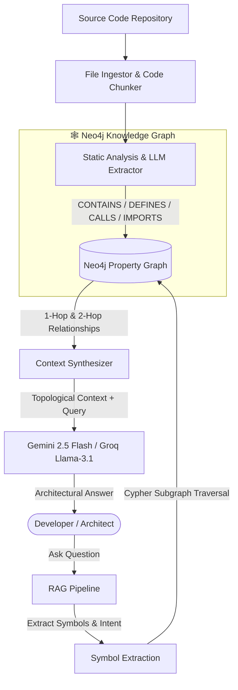

# 🧠 CodeGraph-RAG: Graph-Augmented Codebase Intelligence

[](https://python.org)
[](https://neo4j.com)
[](https://aistudio.google.com)
[](https://groq.com)
[](#roadmap)

An advanced **Graph-Augmented Retrieval Engine (GraphRAG)** designed specifically for large software repositories. Translates codebases into high-fidelity **Neo4j Knowledge Graphs**, preserving call graphs, class inheritance, and dependency topology to answer architectural and relationship questions that traditional vector RAG misses.

---

## 🎯 Why Vector RAG Fails for Code

Traditional RAG chunks source code into arbitrary text windows and embeds them into vector space. While vector search is effective for surface-level keyword/concept matching (*"Where is the user login endpoint?"*), it fundamentally fails when answering structural questions:
- *"Which downstream functions are affected if I modify `calculate_hypotenuse`?"*
- *"Trace the call chain from the HTTP controller down to the database query."*
- *"List all classes inheriting from `BaseTransformer` that import `torch.nn`."*

Code is not unstructured prose; code is a **directed dependency graph**. **CodeGraph-RAG** parses code into structural entities and persists them in Neo4j, enabling multi-hop graph traversals combined with LLM answer synthesis.

---

## 🏗️ System Architecture



---

## 🕸️ Knowledge Graph Schema

```
(:File)        -[:CONTAINS]-> (:Class | :Function)
(:Class)       -[:DEFINES]->  (:Function)
(:Class)       -[:INHERITS]-> (:Class)
(:Function)    -[:CALLS]->    (:Function)
(:File)        -[:IMPORTS]->  (:Library | :Module)
```

| Node Type | Properties | Description |
|---|---|---|
| `File` | `name`, `path` | Source code file representation |
| `Class` | `name` | Class definitions |
| `Function` | `name` | Functions and class methods |
| `Library` | `name` | Imported third-party libraries and modules |

---

## ✨ Features

- 🧬 **Graph Construction from Code:** Parses repositories and extracts functions, classes, dependencies, and call relationships.
- ⚡ **Multi-LLM Engine:** Native support for Google Gemini 2.5 Flash (`google-genai` SDK) and Groq LPU inference (`llama-3.1-70b-versatile`).
- 🐳 **Instant Neo4j Infrastructure:** Spin up a local Neo4j 5.x graph instance with APOC plugins via Docker Compose in seconds.
- 🔍 **Hybrid Query Strategy:** Specific symbol match with fallback to high-degree graph hubs for macro-architectural overviews.
- 💻 **Flexible CLI:** Interactive chat mode, automated batch building, and single-shot scripted queries.

---

## 🚀 Quick Start

### 1. Prerequisites
- Python 3.10+
- Docker & Docker Compose
- Google Gemini API key or Groq API key

### 2. Setup

```bash
# Clone repository
git clone https://github.com/null-charac69/gemini-graph-rag.git
cd gemini-graph-rag

# Create virtual environment
python -m venv venv
source venv/bin/activate  # Windows: venv\Scripts\activate

# Install dependencies
pip install -r requirements.txt

# Configure environment
cp .env.example .env
# Edit .env and enter your GOOGLE_API_KEY or GROQ_API_KEY
```

### 3. Start Neo4j via Docker

```bash
docker compose up -d
```
Neo4j Browser UI is available at `http://localhost:7474` (User: `neo4j`, Password: `password`).

### 4. Build Knowledge Graph from a Codebase

```bash
# Ingest sample repository (or any custom directory via --repo)
python main.py --build --repo data --wipe
```

### 5. Ask Questions

```bash
# Interactive Chat
python main.py

# Or one-shot query from CLI:
python main.py --query "What does the zorbflux module define and what are its dependencies?"
```

---

## 🗺️ WIP Roadmap & Future Milestones

- [x] **v0.5 (Current Milestone):** Neo4j graph storage, LLM-based entity extractor, unified Gemini/Groq support, Docker setup.
- [ ] **v0.6:** Deterministic AST extraction via Tree-Sitter for Python, TypeScript, and Go (eliminates LLM extraction latency & cost during ingestion).
- [ ] **v0.7:** Dynamic Text-to-Cypher generation allowing arbitrary multi-hop graph queries.
- [ ] **v0.8:** Interactive visual graph UI (D3.js / React Flow) integrated directly with chat.

---

## 📄 License & Author

- **Author:** Anant Thakur ([@null-charac69](https://github.com/null-charac69))
- **License:** MIT
